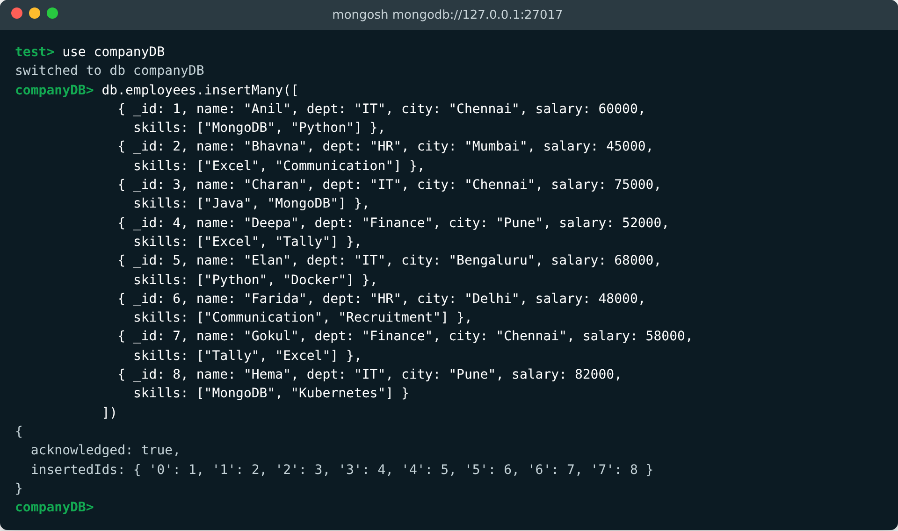
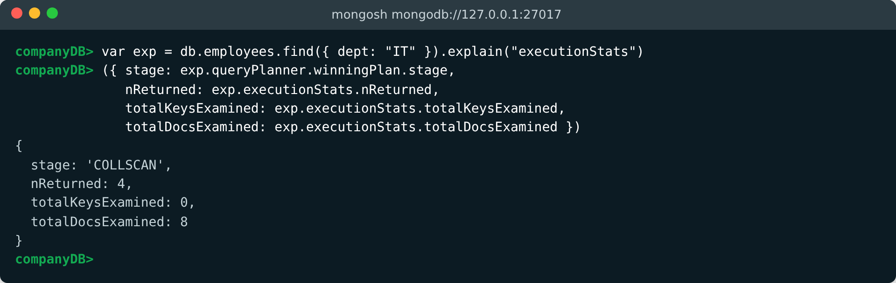
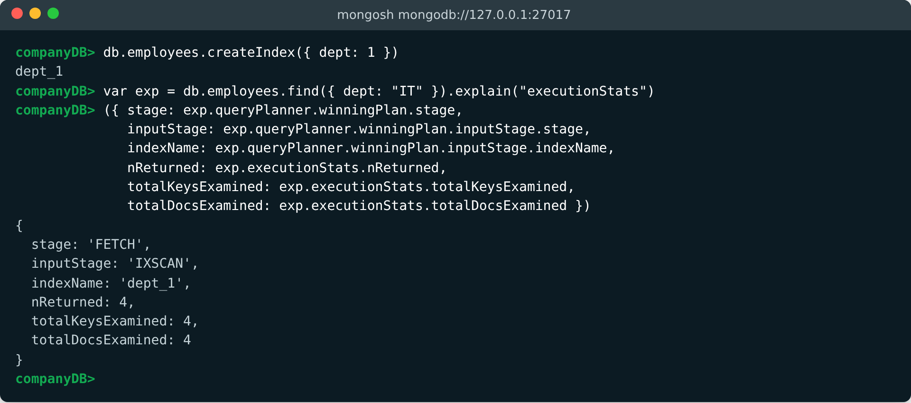
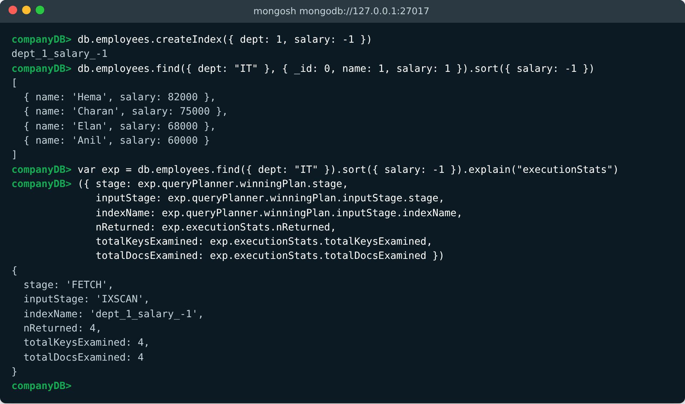
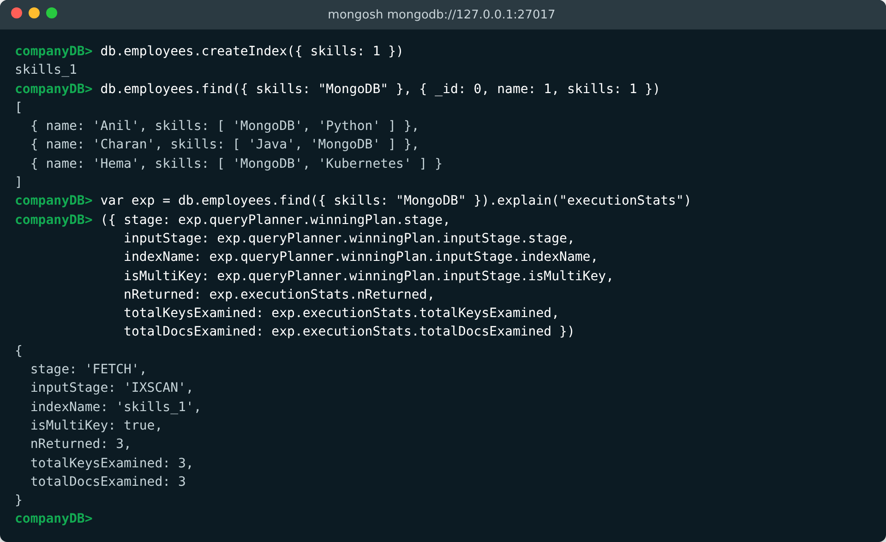
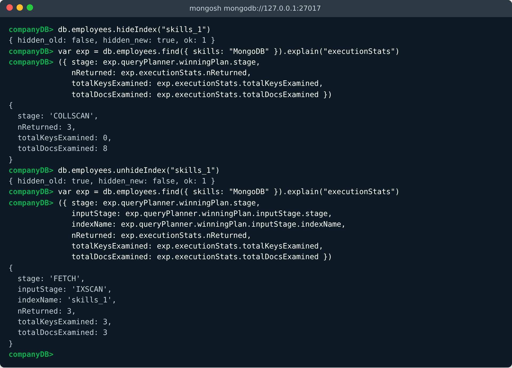
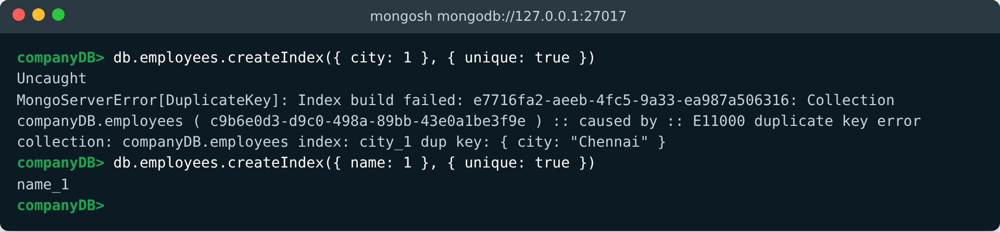
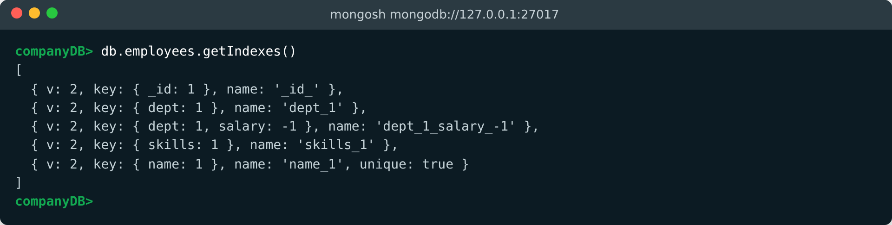

# Scenario A3: Employee Directory – Speeding up Searches with Indexes

**Syllabus focus:** Unit 3: Single-field, compound and multikey indexes, explain plan, hidden index, index errors, index validation, index order
**Database / Collection:** `companyDB.employees`

All queries for this scenario in one file: [`solution.js`](solution.js)

---

## Question

### Scenario

The HR department of a company keeps employee details in the `employees` collection. As the data grows, searching by department and by skill is becoming slow. You must improve the performance using indexes and verify every improvement with `explain("executionStats")`.

The sample below has only 8 documents so that results are easy to verify. In real life the collection would hold lakhs of documents, where the difference is much bigger.

```js
use companyDB
db.employees.insertMany([
  { _id: 1, name: "Anil", dept: "IT", city: "Chennai", salary: 60000,
    skills: ["MongoDB", "Python"] },
  { _id: 2, name: "Bhavna", dept: "HR", city: "Mumbai", salary: 45000,
    skills: ["Excel", "Communication"] },
  { _id: 3, name: "Charan", dept: "IT", city: "Chennai", salary: 75000,
    skills: ["Java", "MongoDB"] },
  { _id: 4, name: "Deepa", dept: "Finance", city: "Pune", salary: 52000,
    skills: ["Excel", "Tally"] },
  { _id: 5, name: "Elan", dept: "IT", city: "Bengaluru", salary: 68000,
    skills: ["Python", "Docker"] },
  { _id: 6, name: "Farida", dept: "HR", city: "Delhi", salary: 48000,
    skills: ["Communication", "Recruitment"] },
  { _id: 7, name: "Gokul", dept: "Finance", city: "Chennai", salary: 58000,
    skills: ["Tally", "Excel"] },
  { _id: 8, name: "Hema", dept: "IT", city: "Pune", salary: 82000,
    skills: ["MongoDB", "Kubernetes"] }
])
```

### Requirements

1. Run `explain("executionStats")` for the query that finds all employees of the IT department, and note the stage used and the number of documents examined.
2. Create a single-field index on `dept` and run the same explain again.
3. Create a compound index on `dept` (ascending) and `salary` (descending), then list IT employees sorted by highest salary and check that no in-memory sort is needed.
4. Create an index on the `skills` array and find all employees who know "MongoDB".
5. Hide the `skills_1` index, run the MongoDB-skill query again to see the effect, and then unhide the index.
6. Try to create a unique index on `city`. Read the error and explain it. Then create a unique index on a suitable field.
7. List all indexes of the collection.

---

## Solution

> All screenshots in this scenario are from a real run on MongoDB 7.0.34 with mongosh 2.3.8. They are stored in the [`screenshots/`](screenshots/) folder.

> In the `explain()` output, the important fields are:
> - `queryPlanner.winningPlan`: the **stage** (`COLLSCAN`, `IXSCAN`, `FETCH`, `SORT`) and the `indexName` used
> - `executionStats.nReturned`: documents returned
> - `executionStats.totalKeysExamined`: index entries scanned
> - `executionStats.totalDocsExamined`: documents read from the collection
>
> In an ideal query, `nReturned`, `totalKeysExamined` and `totalDocsExamined` are all equal.

**Sample data inserted:**



### Task 1: Explain plan without an index

```js
db.employees.find({ dept: "IT" }).explain("executionStats")
```

**Output (important parts)**
```js
winningPlan: { stage: 'COLLSCAN', filter: { dept: { '$eq': 'IT' } }, direction: 'forward' }
executionStats: {
  nReturned: 4,
  totalKeysExamined: 0,
  totalDocsExamined: 8,
  ...
}
```

**Observation:** Stage is **`COLLSCAN`** (collection scan). MongoDB had to read **all 8 documents** to return the 4 IT employees (Anil, Charan, Elan, Hema). With lakhs of documents this becomes very slow.

**Screenshot:**



---

### Task 2: Single-field index on `dept`

```js
db.employees.createIndex({ dept: 1 })
```
**Output:** `dept_1`

```js
db.employees.find({ dept: "IT" }).explain("executionStats")
```

**Output (important parts)**
```js
winningPlan: {
  stage: 'FETCH',
  inputStage: { stage: 'IXSCAN', keyPattern: { dept: 1 }, indexName: 'dept_1', ... }
}
executionStats: {
  nReturned: 4,
  totalKeysExamined: 4,
  totalDocsExamined: 4,
  ...
}
```

**Observation:** Stage is now **`IXSCAN` → `FETCH`** using `dept_1`. Only the **4 matching documents** are examined instead of 8. Nothing is wasted: keys examined = documents examined = documents returned.

| | Before index | After index |
|---|---|---|
| Stage | `COLLSCAN` | `IXSCAN` + `FETCH` |
| totalKeysExamined | 0 | 4 |
| totalDocsExamined | 8 | 4 |
| nReturned | 4 | 4 |

**Screenshot:**



---

### Task 3: Compound index – `dept` (asc) + `salary` (desc)

```js
db.employees.createIndex({ dept: 1, salary: -1 })
```
**Output:** `dept_1_salary_-1`

```js
db.employees.find({ dept: "IT" }, { _id: 0, name: 1, salary: 1 })
  .sort({ salary: -1 })
```

**Output**
```js
[
  { name: 'Hema',   salary: 82000 },
  { name: 'Charan', salary: 75000 },
  { name: 'Elan',   salary: 68000 },
  { name: 'Anil',   salary: 60000 }
]
```

```js
db.employees.find({ dept: "IT" }).sort({ salary: -1 }).explain("executionStats")
```

**Output (important parts)**
```js
winningPlan: {
  stage: 'FETCH',
  inputStage: {
    stage: 'IXSCAN',
    keyPattern: { dept: 1, salary: -1 },
    indexName: 'dept_1_salary_-1',
    ...
  }
}
executionStats: { nReturned: 4, totalKeysExamined: 4, totalDocsExamined: 4, ... }
```

**Observation:** There is **no `SORT` stage** in the winning plan, so **no in-memory sort is needed**. Inside the compound index, entries for `dept: "IT"` are already stored in descending `salary` order, so MongoDB just reads them in index order.

(If only `dept_1` were used, the plan would contain a `SORT` stage above the `IXSCAN`, meaning the results are sorted in memory.)

**Order matters (ESR rule: Equality, Sort, Range):** put the field used for equality (`dept`) first and the sort field (`salary`) next. With `{ salary: 1, dept: 1 }`, MongoDB could not use the index to filter by department efficiently, because the entries would be ordered by salary first and IT employees would be scattered through the whole index. The index also supports `.sort({ salary: 1 })` by scanning backwards, and queries on `dept` alone (prefix), but **not** queries on `salary` alone.

**Screenshot:**



---

### Task 4: Multikey index on the `skills` array

```js
db.employees.createIndex({ skills: 1 })
```
**Output:** `skills_1`

```js
db.employees.find({ skills: "MongoDB" }, { _id: 0, name: 1, skills: 1 })
```

**Output**
```js
[
  { name: 'Anil',   skills: [ 'MongoDB', 'Python' ] },
  { name: 'Charan', skills: [ 'Java', 'MongoDB' ] },
  { name: 'Hema',   skills: [ 'MongoDB', 'Kubernetes' ] }
]
```

```js
db.employees.find({ skills: "MongoDB" }).explain("executionStats")
```

**Output (important parts)**
```js
inputStage: { stage: 'IXSCAN', keyPattern: { skills: 1 }, indexName: 'skills_1',
              isMultiKey: true, multiKeyPaths: { skills: [ 'skills' ] }, ... }
executionStats: { nReturned: 3, totalKeysExamined: 3, totalDocsExamined: 3, ... }
```

**Explanation:** When an index is created on an array field, MongoDB automatically makes it a **multikey index**. It stores **one index entry for every element** of the array, so each employee here has 2 entries. `isMultiKey: true` in the explain output confirms this.

**Screenshot:**



---

### Task 5: Hide and unhide the `skills_1` index

```js
db.employees.hideIndex("skills_1")
```
**Output**
```js
{ hidden_old: false, hidden_new: true, ok: 1 }
```

```js
db.employees.find({ skills: "MongoDB" }).explain("executionStats")
```
**Output (important parts)**
```js
winningPlan: { stage: 'COLLSCAN', filter: { skills: { '$eq': 'MongoDB' } }, ... }
executionStats: { nReturned: 3, totalKeysExamined: 0, totalDocsExamined: 8, ... }
```

**Effect:** The query still returns the same 3 employees, but the planner can no longer use the hidden index. It falls back to a **`COLLSCAN`** and examines all 8 documents.

```js
db.employees.unhideIndex("skills_1")
```
**Output**
```js
{ hidden_old: true, hidden_new: false, ok: 1 }
```

Running the explain again shows `IXSCAN` on `skills_1` with 3 documents examined.

**Why hide an index?** A hidden index is still **maintained** on every write, but the query planner ignores it (hidden indexes require MongoDB 4.4 or later). This lets you test what would happen if you dropped an index, without actually dropping it. If performance gets worse, you just unhide it instead of rebuilding the whole index.

**Screenshot:**



---

### Task 6: Unique index errors

```js
db.employees.createIndex({ city: 1 }, { unique: true })
```

**Output (error)**
```
MongoServerError[DuplicateKey]: Index build failed: <uuid>: Collection companyDB.employees
( <uuid> ) :: caused by :: E11000 duplicate key error collection: companyDB.employees
index: city_1 dup key: { city: "Chennai" }
```

**Explanation:** A unique index guarantees that no two documents have the same value for the indexed field. The collection **already contains duplicate cities**: "Chennai" appears 3 times (Anil, Charan, Gokul) and "Pune" twice (Deepa, Hema). MongoDB cannot build a unique index over data that already breaks the rule, so the index build fails and **no index is created**. City is not a good candidate for uniqueness anyway, because many employees can live in the same city.

**Unique index on a suitable field:** every employee in this data has a different `name`, so:

```js
db.employees.createIndex({ name: 1 }, { unique: true })
```
**Output:** `name_1`

From now on, inserting another employee named, for example, "Anil" fails with an `E11000 duplicate key` error. (In a real company, a field such as an employee code or email ID would be a better choice for a unique index, because two people can share a name.)

**Screenshot:**



---

### Task 7: List all indexes

```js
db.employees.getIndexes()
```

**Output**
```js
[
  { v: 2, key: { _id: 1 }, name: '_id_' },
  { v: 2, key: { dept: 1 }, name: 'dept_1' },
  { v: 2, key: { dept: 1, salary: -1 }, name: 'dept_1_salary_-1' },
  { v: 2, key: { skills: 1 }, name: 'skills_1' },
  { v: 2, key: { name: 1 }, name: 'name_1', unique: true }
]
```

**Explanation:** `_id_` is created automatically with every collection. The failed `city_1` index does not appear. `skills_1` shows no `hidden` flag because it was unhidden in Task 5.

**Screenshot:**



---

## Summary of index types used

| Index | Type | Purpose |
|-------|------|---------|
| `_id_` | Default, unique | Primary key |
| `dept_1` | Single-field | Equality search on department |
| `dept_1_salary_-1` | Compound | Filter by dept + sort by salary without an in-memory sort |
| `skills_1` | Multikey | Search inside the `skills` array |
| `name_1` | Unique | Prevents duplicate employee names |
